# Ghumante (घुमन्ते)

*"Wanderer": a bright, chunky, cartoon open-world explorer of the **real** Nepal, for iOS and Android.*

Ride a motorbike from Thamel to Boudhanath along real streets. Bus up the Prithvi Highway to Pokhara, paraglide off Sarangkot, or trek to Everest Base Camp. Everything is where it really is, built from OpenStreetMap, Copernicus elevation and ESA land-cover data, and drawn as a joyful, saturated cartoon.

> **Status:** M1, Kathmandu Valley vertical slice, in progress (Wave 2 detail pass). See [docs/PROGRESS.md](docs/PROGRESS.md).

## Screenshots

> These are **preview renders**, not captures from the running game. The offline mesh-preview renderer ([`tools/mesh-preview`](tools/mesh-preview/)) draws exactly the meshes the game's own generators build from the Kathmandu sample map. Captures from Unity in Play mode will replace them once they're taken on device.

| | |
|---|---|
| 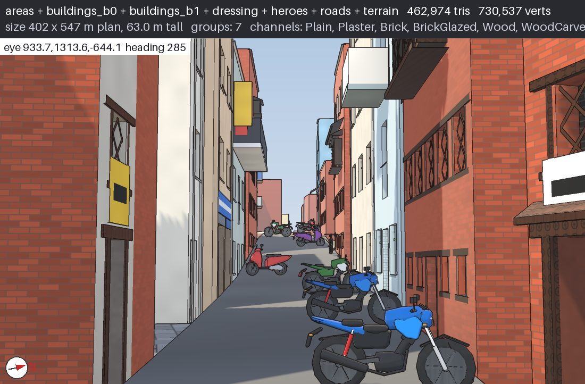 Asan: a narrow old-core lane, widened to be rideable, with parked bikes | 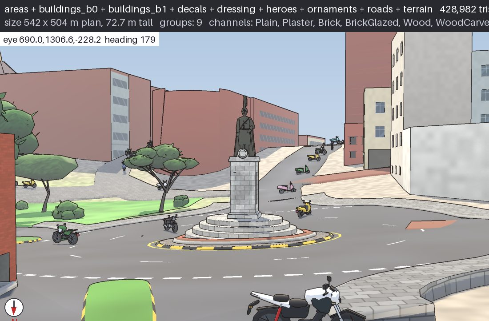 New Road: roundabout with its statue, traffic and kerbs |
| 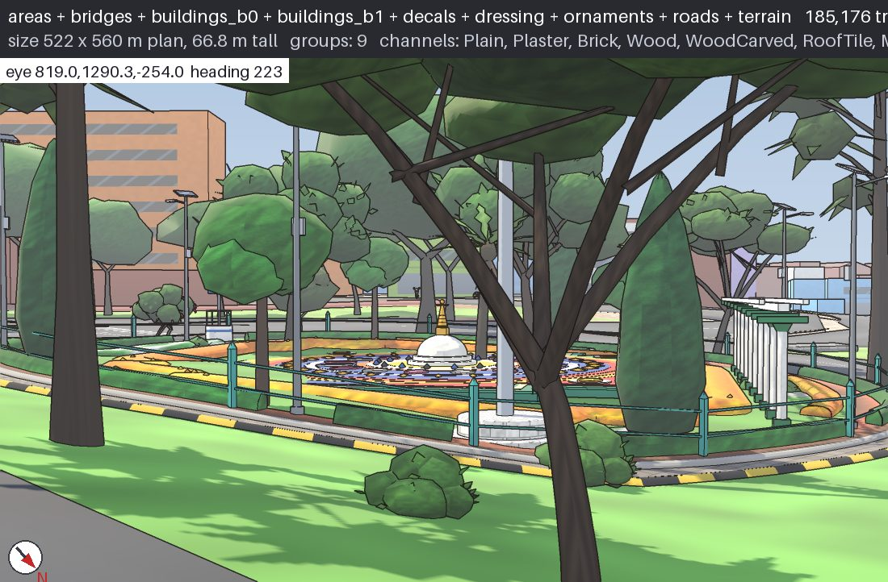 Maitighar Mandala: the island garden and mandala | 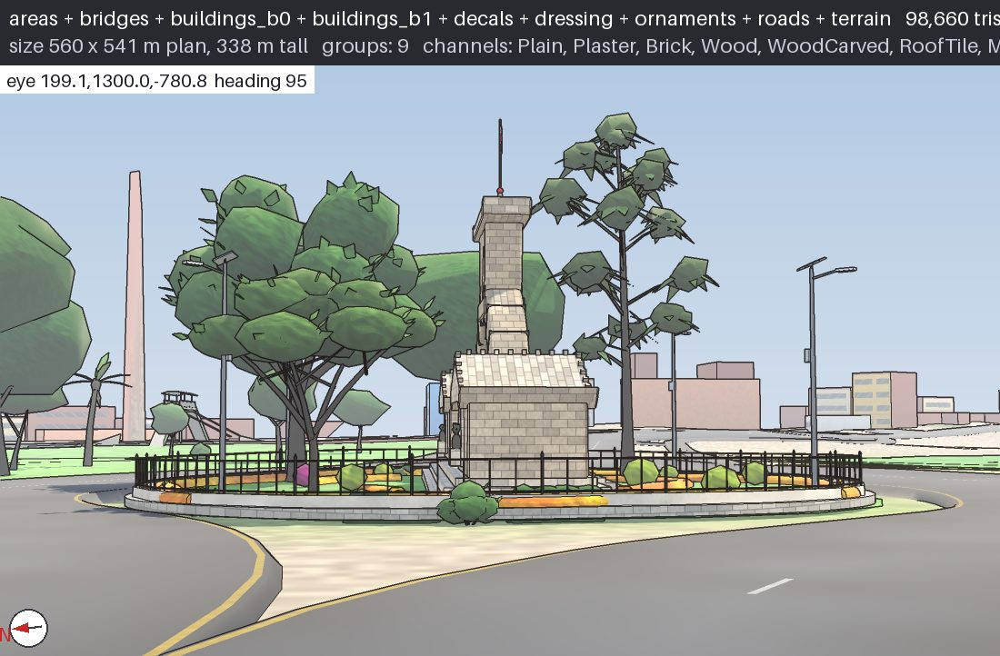 Shahid Gate (Martyrs' Memorial) on its island |
| 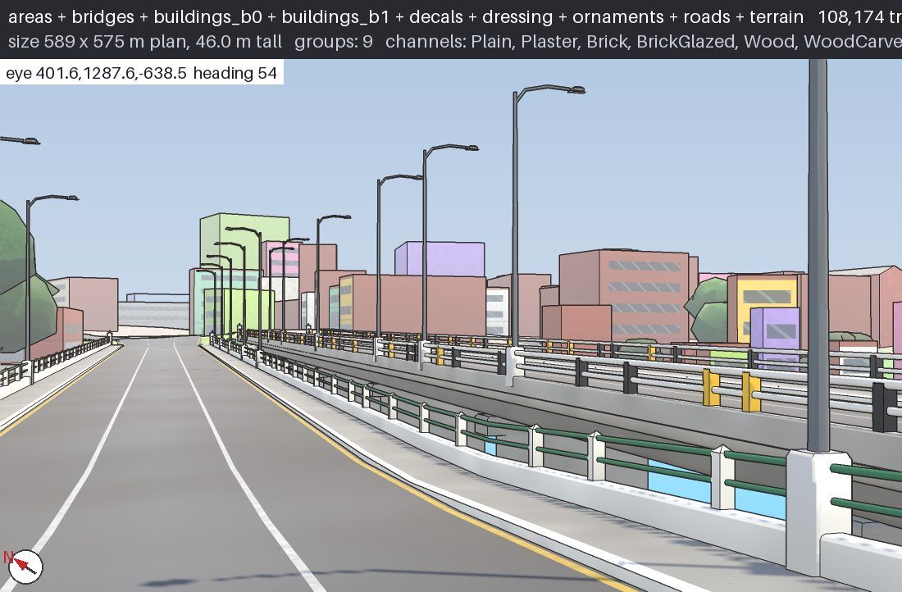 On a Bagmati bridge: railings on both sides, lamp posts | 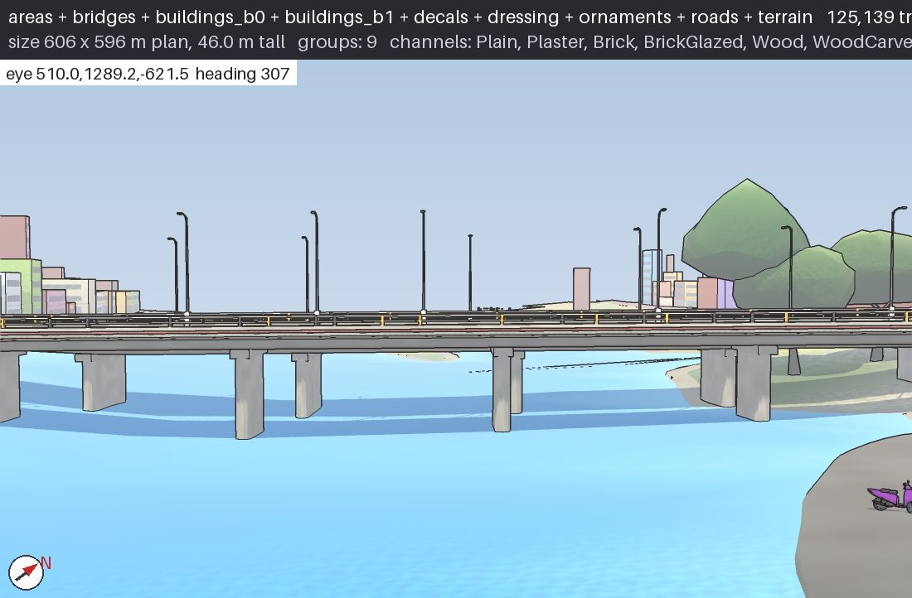 The same kind of bridge from the bank: deck, piers, railings |

**Landmarks and people**

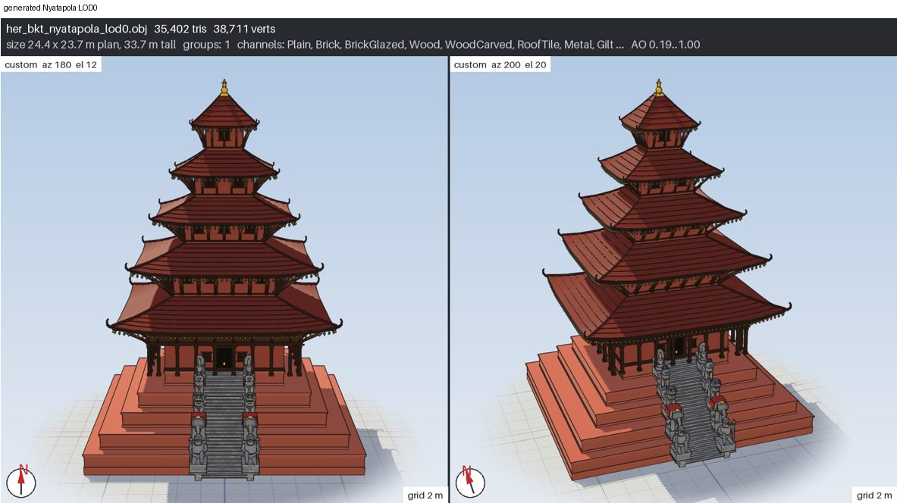
*Nyatapola, Bhaktapur: five roofs on five plinths, struts under every eave, guardian pairs on the stair (33.7 m, real proportions).*

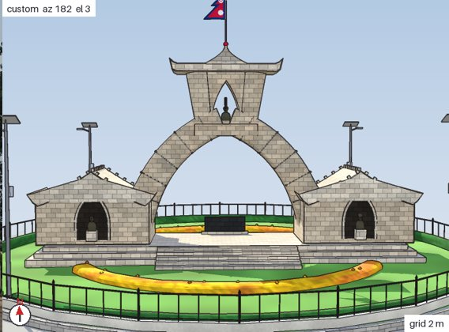 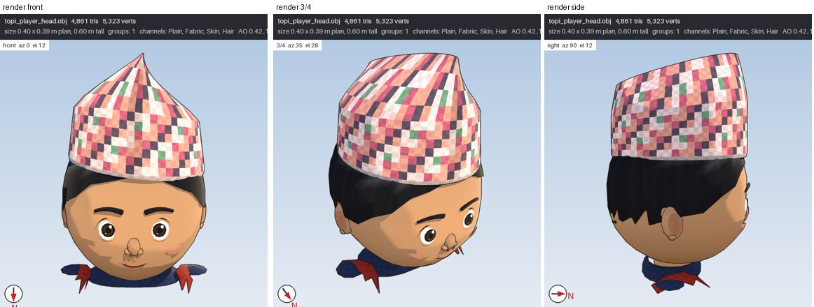
*Shahid Gate front view; the player's dhaka topi from the front, three-quarter and side.*

**Vehicles of today's Kathmandu streets** (generic, unbranded)

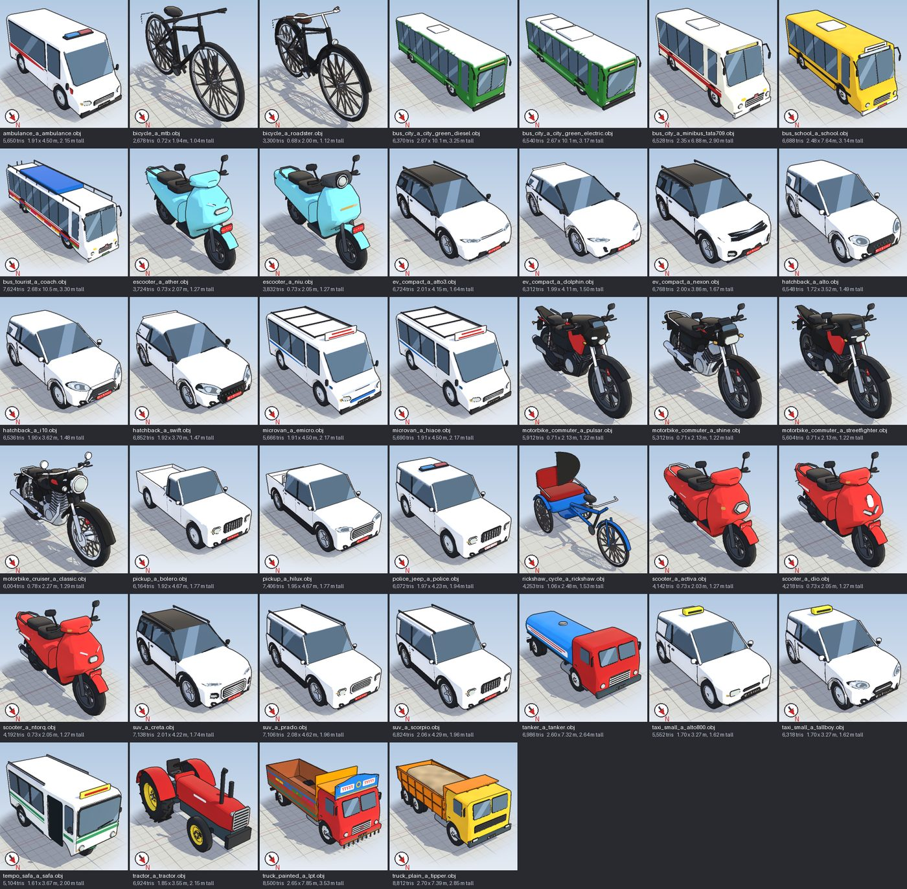

**Animals and birds**

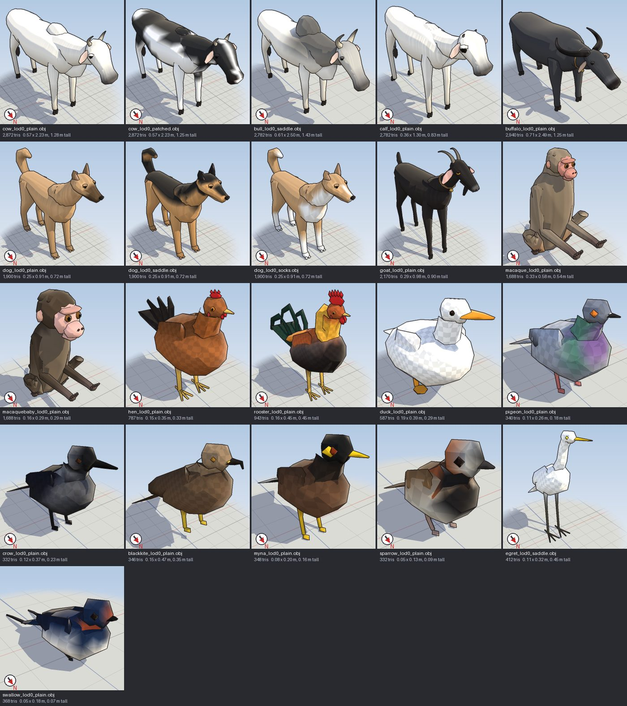

**Seasons on the valley rim** (January, April, July, October)

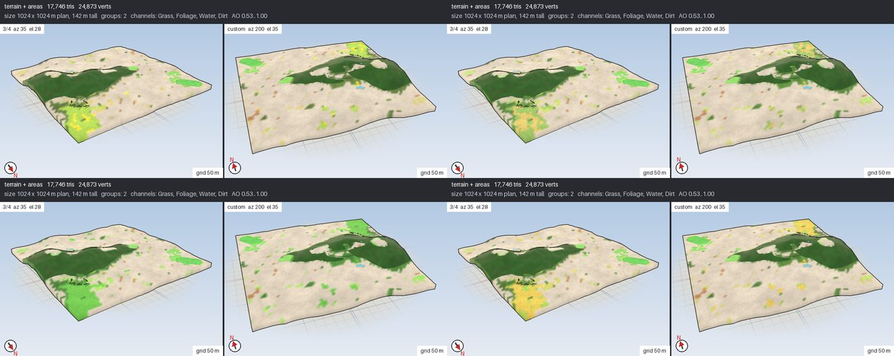

## Repository map

| Path | What |
|---|---|
| [`docs/`](docs/) | [Architecture](docs/ARCHITECTURE.md) · [Roadmap](docs/ROADMAP.md) · [Progress](docs/PROGRESS.md) · [Data formats](docs/DATA_FORMATS.md) · [Licences](docs/LICENSES.md) · [Asset manifest](docs/ASSET_MANIFEST.md) · [Reports](docs/reports/) |
| [`pipeline/`](pipeline/) | Offline Python data pipeline: fetch → extract → infer → tile → pack → search index → routing graph |
| [`game/`](game/) | Unity 6.3 LTS (URP) project |
| `game/Assets/Ghumante/Core/` | Engine-agnostic C# core (data readers, search, routing, save). No `UnityEngine` references |
| [`core-tests/`](core-tests/) | `dotnet test` project for the core, cross-checked against golden files from the Python pipeline |
| [`shared/`](shared/) | Cross-language contracts (`enums.json`, golden files) |
| [`tools/qa-viewer/`](tools/qa-viewer/) | Web viewer that overlays generated tiles on OpenStreetMap |
| `.github/workflows/` | CI: pipeline tests, core tests, localisation check, Unity Android/iOS builds, nightly data refresh |

## Quick start (data pipeline)

Large downloads and generated files stay on your machine, outside Git:

* `pipeline/data/`: downloaded OSM, elevation and land-cover data, including the source checksum lock.
* `pipeline/build/` and `pipeline/.cache/`: generated region packs, extraction caches and QA exports.
* `game/Assets/StreamingAssets/Regions/`: region packs imported into Unity.
* `game/Builds/` and `game/ios/`: generated player builds and Xcode exports, including `Libraries/libiPhone-lib.a`.
* Unity's `game/Library/`, `game/Temp/` and other generated caches.

The compact [Kathmandu core sample](shared/sample-regions/) remains committed so you can play and run sample-based tests without downloading the full datasets. Keep Unity source assets, their `.meta` files, project settings and pipeline configuration in Git.

### Download OSM, elevation and land cover

Install Python 3.11 or newer, then run these commands from the repository root:

```bash
cd pipeline
python3 -m venv .venv
source .venv/bin/activate                     # Windows: .venv\Scripts\activate
python -m pip install -e ".[dev]"
python fetch.py --region kathmandu_valley --dry-run  # preview the required files
python fetch.py --region kathmandu_valley           # download all three datasets
python fetch.py --region kathmandu_valley --verify  # check local sizes and SHA-256 hashes
```

The downloader uses the sources in [`pipeline/config/sources.yaml`](pipeline/config/sources.yaml): the Nepal OpenStreetMap extract from Geofabrik (with an OSMToday fallback), Copernicus GLO-30 elevation and ESA WorldCover 2021 v200. It writes:

* `pipeline/data/raw/osm/nepal.osm.pbf`
* `pipeline/data/raw/dem/copernicus/*.tif`
* `pipeline/data/raw/worldcover/*.tif`
* `pipeline/data/raw/SOURCES.lock.json`, recording downloaded URLs, sizes and checksums.

These downloads are large; allow several GB of free disk space for sources, caches and outputs. If interrupted, rerun the same fetch command to resume supported downloads. To fetch only OSM, add `--only osm`; building a playable region still requires the elevation and land-cover files. The OSM URL supplies the latest extract, so a later download can produce a different map; retain your local sources and lock file when you need to rebuild the same data.

### Build and import a region

With the virtual environment still active in `pipeline/`:

```bash
python build.py --region kathmandu_valley --qa # build the pack, indexes, side files and QA export
python -m pytest -q                           # run pipeline tests
python ../tools/qa-viewer/serve.py             # open the printed URL to inspect the build over OSM
```

The output is `pipeline/build/regions/kathmandu_valley/`. In Unity, select **Ghumante → Import Region Pack...** and choose that folder. The importer checks the manifest and copies its files into the ignored `game/Assets/StreamingAssets/Regions/` directory. Use `thamel_test` instead of `kathmandu_valley` in the fetch and build commands for a smaller region build; the OSM download still covers Nepal. Details: [pipeline/README.md](pipeline/README.md).

### Restore Unity data and generate the iOS project

1. Install the Unity version recorded in [`game/ProjectSettings/ProjectVersion.txt`](game/ProjectSettings/ProjectVersion.txt), with **iOS Build Support** for iOS exports, and open `game/` as the Unity project.
2. Run **Ghumante → Project Setup** to restore the committed sample into `StreamingAssets/Regions/`. Import the full valley pack above if needed.
3. On macOS, select **Ghumante → Build → iOS Xcode Project**. The build script generates `game/Builds/iOS/`, including the native libraries. Open the generated project in Xcode for signing and device builds. See [game/README.md](game/README.md) for the complete Unity/build setup.

An existing `game/ios/` folder is also a generated export and is ignored. Rebuild it using the menu above instead of committing it. Adding a path to `.gitignore` does not remove it from an earlier commit; if a push reports a large file from an already-created local commit, that file must also be removed from the unpushed history before retrying.

## Attribution

Map data © [OpenStreetMap](https://www.openstreetmap.org/copyright) contributors (ODbL). Elevation: produced using Copernicus WorldDEM-30 © DLR e.V. 2010-2014 and © Airbus Defence and Space GmbH 2014-2018 provided under COPERNICUS by the European Union and ESA; all rights reserved. Land cover: © ESA WorldCover project 2021 / Contains modified Copernicus Sentinel data (2021) processed by ESA WorldCover consortium (CC BY 4.0). Full details in [docs/LICENSES.md](docs/LICENSES.md).
